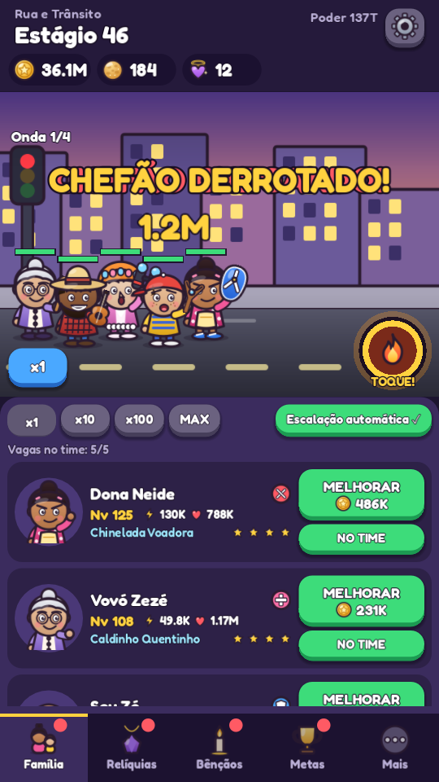
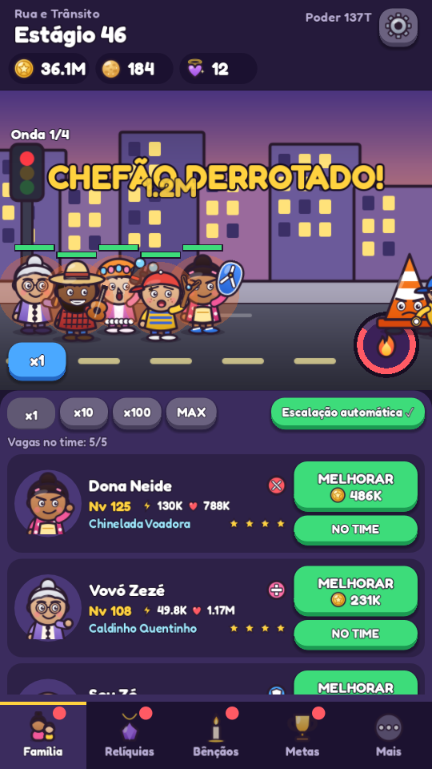
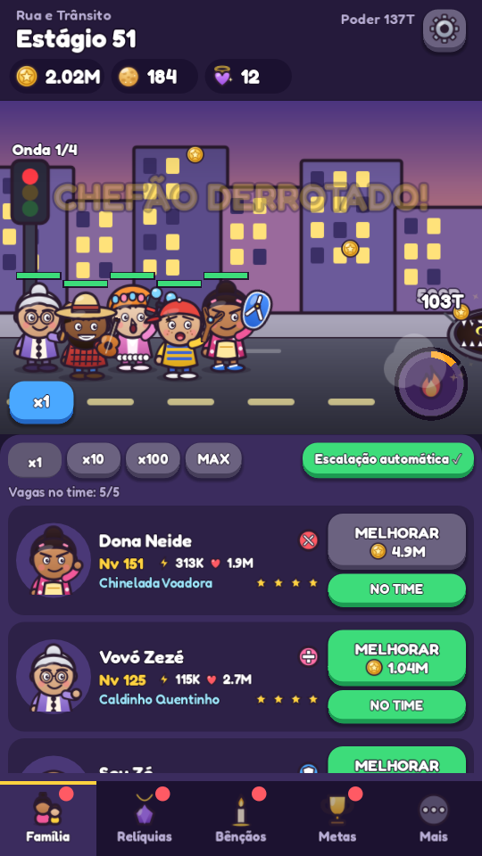
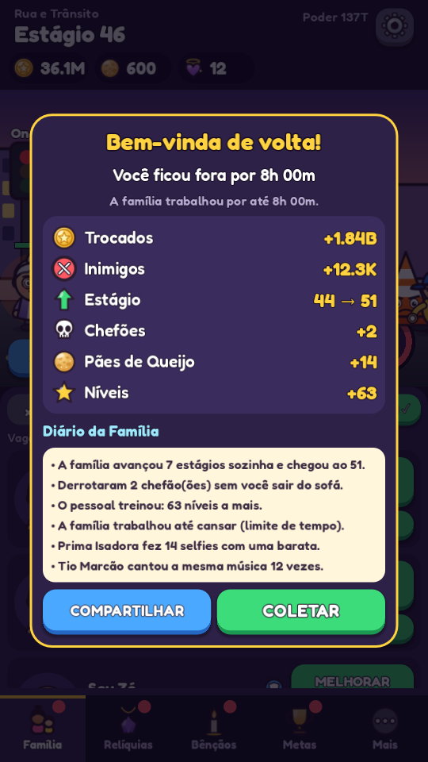
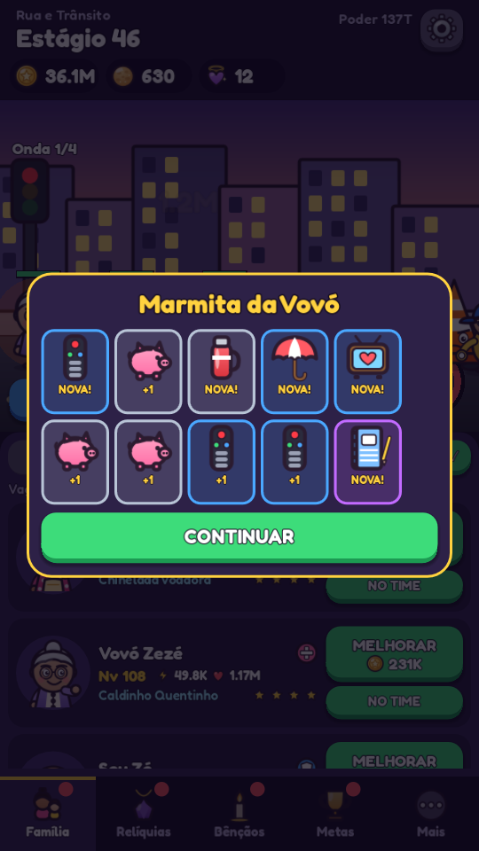
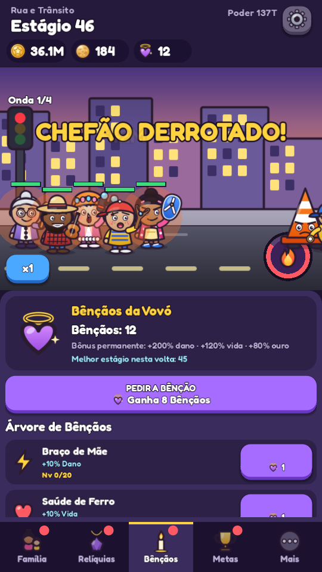
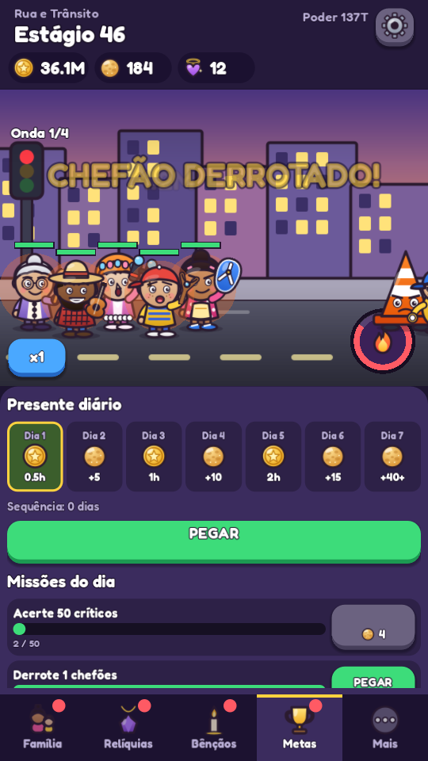
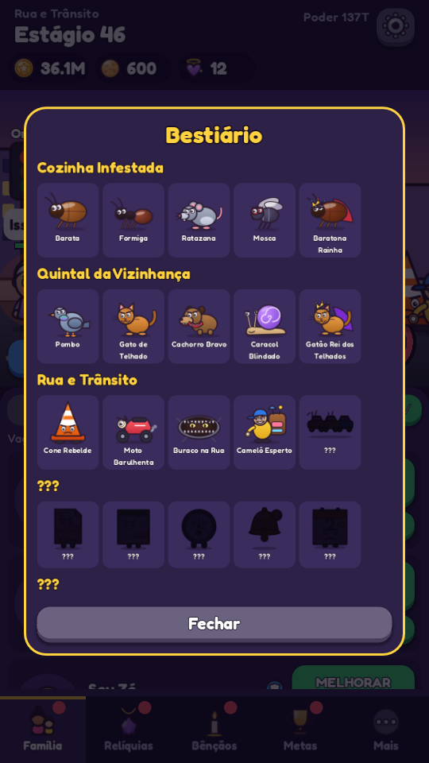
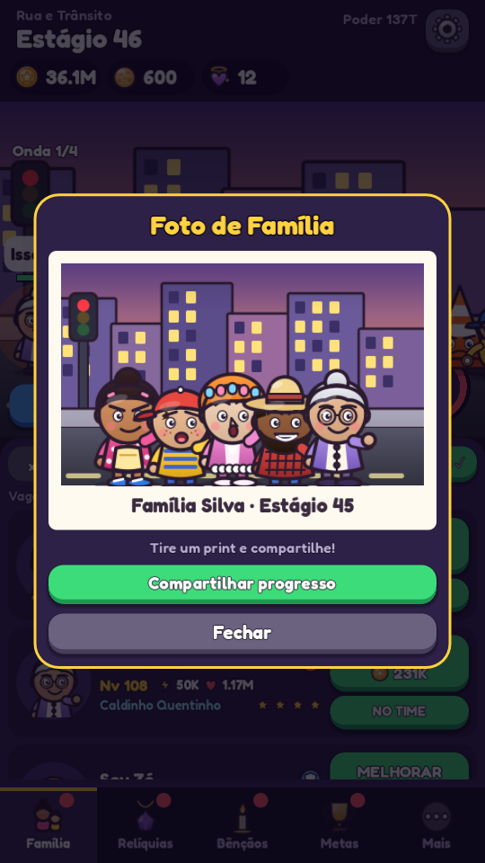

# 🩴 Chinelada: Heróis do Lar

> **Idle RPG brasileiro feito em Godot 4.7.** A família defende o lar contra os perrengues do cotidiano — e continua farmando mesmo com o app fechado!

[](https://godotengine.org/)
[](#arquitetura-de-código)
[](#como-jogar-e-executar)
[](#filosofia-do-projeto)
[](#segurança-e-privacidade)
[](LICENSE)

---

## 📌 Sumário
- [Visão Geral](#-visão-geral)
- [Capturas de Tela (Screenshots)](#-capturas-de-tela-screenshots)
- [Filosofia do Projeto](#-filosofia-do-projeto)
- [A Família (Heróis)](#-a-família-heróis)
- [Mundos e Perrengues (Inimigos)](#-mundos-e-perrengues-inimigos)
- [Sistemas e Mecânicas](#-sistemas-e-mecânicas)
  - [Combate e Automação](#combate-e-automação)
  - [Fúria da Mãe e Ações Interativas](#fúria-da-mãe-e-ações-interativas)
  - [Marmita da Vovó (Relíquias)](#marmita-da-vovó-relíquias)
  - [Bênção da Vovó (Prestígio)](#bênção-da-vovó-prestígio)
  - [Farm Offline Preditivo (Diário da Família)](#farm-offline-preditivo-diário-da-família)
  - [Fornada da Vovó, Metas e Códigos](#fornada-da-vovó-metas-e-códigos)
- [Arquitetura de Código](#-arquitetura-de-código)
- [Ferramentas de Teste e Balanceamento](#-ferramentas-de-teste-e-balanceamento)
- [Como Jogar e Executar](#-como-jogar-e-executar)
- [Como Exportar e Publicar](#-como-exportar-e-publicar)
- [Códigos Promocionais](#-códigos-promocionais)
- [Créditos e Licença](#-créditos-e-licença)

---

## 🎮 Visão Geral

**Chinelada: Heróis do Lar** é um Idle RPG com temática e humor genuinamente brasileiros desenvolvido para celular (modo retrato, resolução base `720×1280`), desktop e web.

A premissa é simples e cativante: uma família unida protege sua casa contra as maiores ameaças do cotidiano moderno — desde uma barata voadora na cozinha e um gato fofoqueiro no muro, até o temido Leão do Imposto de Renda e a Segunda-Feira de manhã.

Quando você fecha o jogo para viver a sua vida, a família não descansa: através de um motor preditivo offline exclusivo, eles continuam enfrentando ondas, coletando ouro e avançando estágios. Ao reabrir o app, o **Diário da Família** relata tudo o que aconteceu durante a sua ausência!

---

## 📸 Capturas de Tela (Screenshots)

<div align="center">
  <table>
    <tr>
      <td align="center" width="33%">
        <b>⚔️ Combate em Tempo Real</b><br><br>
        
      </td>
      <td align="center" width="33%">
        <b>🔥 Fúria da Mãe (2x Dano)</b><br><br>
        
      </td>
      <td align="center" width="33%">
        <b>👑 Batalha de Chefão</b><br><br>
        
      </td>
    </tr>
    <tr>
      <td align="center" width="33%">
        <b>📜 Diário da Família (Offline)</b><br><br>
        
      </td>
      <td align="center" width="33%">
        <b>🍲 Marmita da Vovó (Gacha)</b><br><br>
        
      </td>
      <td align="center" width="33%">
        <b>✨ Árvore de Bênçãos (Prestígio)</b><br><br>
        
      </td>
    </tr>
    <tr>
      <td align="center" width="33%">
        <b>🎯 Metas e Missões Diárias</b><br><br>
        
      </td>
      <td align="center" width="33%">
        <b>📖 Bestiário dos Perrengues</b><br><br>
        
      </td>
      <td align="center" width="33%">
        <b>📷 Foto de Família (Compartilhar)</b><br><br>
        
      </td>
    </tr>
  </table>
</div>

---

## 💡 Filosofia do Projeto

- **100% Autoral e Independente:** Todo o código, arte e áudio foram criados do zero para o jogo.
- **Arte Vetorial Procedural:** Todos os personagens, inimigos, ícones e cenários são gerados por código GDScript em SVG (`art/src/`) e assados em texturas de alta definição (`art/baked/`).
- **Áudio Sintetizado:** Efeitos sonoros e trilhas musicais (com loops perfeitos) foram gerados matematicamente por síntese sonora em Python/NumPy (`tools/gen_audio.py`).
- **Zero Predação / Zero Monetização Abusiva:** Sem anúncios obrigatórios, sem compras no aplicativo (IAP), sem timers predatórios de energia e sem conexão com a internet exigida.
- **Privacidade Total:** Zero rastreamento, zero telemetria e nenhuma permissão além de vibração tátil (*haptics*).
- **Simulação Headless Determinística:** A lógica de combate (`BattleSim`) e progressão não depende de nós da `SceneTree` do Godot. Isso permite que a simulação de farm offline, bots de balanceamento e testes unitários usem exatamente as mesmas regras matemáticas do jogo em tempo real.
- **Navegação 100% Fluida por Toque:** Toda a interface foi pensada para toque no celular (*touch-first*), com rolagem suave por gestos em qualquer ponto da tela e sem barras de rolagem visíveis.

---

## 👥 A Família (Heróis)

O jogador pode recrutar até 8 integrantes da família e montar formações estratégicas de até 5 membros simultâneos:

| Herói | Papel | Arma | Desbloqueio | Habilidade Especial | Descrição |
|---|---|---|:---:|---|---|
| **Dona Neide** | Melee / Burst | Chinelo Havaiana | Estágio 1 | *Chinelada Certeira* (3.5x dano + atordoamento) | A matriarca da casa. Nenhuma barata escapa do seu arremesso de chinelo. |
| **Vovó Zezé** | Healer | Colher de Pau | Estágio 4 | *Chazinho Milagroso* (Cura em área do time) | Cura os heróis com remédios caseiros e doces de compota. |
| **Seu Zé** | Tank | Espeto de Churrasco | Estágio 8 | *Churrasco no Bafo* (Provoca inimigos + escudo + queimadura) | Fica na linha de frente aguentando o tranco com seu espeto em mãos. |
| **Caramelo** | Melee / Dano Ágil | Mordida Rápida | Estágio 14 | *Vira-Lata Veloz* (Sequência de 4 ataques rápidos) | O fiel amigo de quatro patas que ataca em disparada com alta velocidade. |
| **Prima Isadora** | Ranged / Cegueira | Celular / Flash | Estágio 22 | *Selfie Cegante* (Dano em área + enfraquece inimigos) | Ataca à distância registrando fotos e Stories que deixam os inimigos desnorteados. |
| **Tio Marcão** | Support / Buff | Violão no Churrasco | Estágio 32 | *Moda de Viola* (Aumenta o ataque e cadência do time) | Apoia a equipe tocando modões sertanejos e clássicos no fundo do quintal. |
| **Pedrinho** | Ranged / Rajada | Estilingue | Estágio 45 | *Pedrada Contínua* (Chuva de 6 pedregulhos velozes) | O caçula arteiro com excelente taxa de acerto crítico de longo alcance. |
| **Dona Fofoca** | Debuff / Controle | Binóculo de Janela | Estágio 60 | *Língua de Trapo* (Aumenta dano recebido e lentidão dos inimigos) | Espalha segredos da vizinhança, reduzindo a defesa e moral dos perrengues. |

---

## 🗺️ Mundos e Perrengues (Inimigos)

O jogo conta com 5 mundos temáticos de 20 estágios cada (totalizando 100 estágios base). Após o 100º estágio, o jogo entra nos infinitos ciclos **Pesadelo** (Pesadelo I, II, III...):

```
[Mundo 1: Cozinha] ➔ [Mundo 2: Quintal] ➔ [Mundo 3: Rua] ➔ [Mundo 4: Escritório] ➔ [Mundo 5: Banco] ➔ [Modo Pesadelo ∞]
```

1. **Cozinha Infestada (Estágios 1 a 20):**
   - *Inimigos:* Barata, Formiga (em enxame), Rato, Mosca (distância).
   - *Chefão:* **Baratona Voadora** (invoca baratas de tempos em tempos).
2. **Quintal da Vizinhança (Estágios 21 a 40):**
   - *Inimigos:* Pombo (sniper), Gato arisco, Cachorro bravo (atordoa), Caracol (escudo).
   - *Chefão:* **Gatão do Telhado** (invoca gatos e atordoa o time).
3. **Rua e Trânsito (Estágios 41 a 60):**
   - *Inimigos:* Cone de trânsito, Motoqueiro barulhento, Buraco no asfalto (dano contínuo), Camelô (rende bônus alto de ouro).
   - *Chefão:* **Engarrafamento Monstro** (invoca motos velocistas).
4. **Escritório e Boletos (Estágios 61 a 80):**
   - *Inimigos:* Boleto vencido, Planilha travada, Reunião infinita (muita vida), Notificação do celular.
   - *Chefão:* **Segunda-Feira de Manhã** (ataque cresce com o tempo e invoca notificações).
5. **Banco e Repartição Pública (Estágios 81 a 100):**
   - *Inimigos:* Fila quilométrica (enxames), Juros compostos (escala dano), Carimbo sem tinta, Senha chamada errada.
   - *Chefão Final:* **Leão do Imposto de Renda** (dano contínuo pesado, atordoamento e invoca carimbos).

---

## ⚙️ Sistemas e Mecânicas

### Combate e Automação
- **Batalha Automática:** A família luta sozinha em tempo real com posicionamento dinâmico.
- **Melhorias em Bloco (Hold-to-buy):** Toque e segure no botão **MELHORAR** para evoluir níveis rapidamente em múltiplos de 1x, 10x, 100x ou no MÁXIMO possível.
- **Auto-Melhorar:** Desbloqueado no estágio 11, compra melhorias de acordo com os pesos ideais dos heróis.
- **Auto-Avançar & Auto-Chefão:** Avança automaticamente pelos estágios. Em caso de derrota na fronteira, o jogo volta para farmar o estágio anterior e tenta novamente de forma inteligente quando o poder do time ultrapassar 15% do poder da derrota.

### Fúria da Mãe e Ações Interativas
- **Fúria da Mãe:** O medidor carrega conforme o combate acontece. Ao ativar (ou via talento de auto-fúria), o time ganha ataque dobrado por 8 segundos com efeitos de chamas!
- **A "Dedada" (Tap Dano):** Toque diretamente nos inimigos na tela de combate para desferir chineladas manuais extras baseadas na média de ataque do grupo.
- **Papagaio Dourado:** Um papagaio lendário que sobrevoa a tela aleatoriamente — toque nele rapidamente para coletar uma montanha de ouro ou Pães de Queijo!

### Marmita da Vovó (Relíquias)
- **16 Relíquias Globais:** Bônus passivos permanentes de ataque, vida, ganho de ouro, cadência, ressurreição em combate (*Santinho*) e eficiência offline (*Caderninho*).
- **Gacha Ético:** Aberto com Pães de Queijo (gemas gratuitas).
- **Pity System Transparente:** Garantia matemática de relíquia **Épica** a cada 30 aberturas e **Lendária** a cada 100 aberturas.

### Bênção da Vovó (Prestígio)
- Ao alcançar o estágio 40 ou superior, o jogador pode reiniciar a jornada para receber **Bênçãos da Vovó**.
- **Árvore de 16 Talentos Permanentes:** Melhore dano global, vida, ganho de ouro, capacidade máxima de farm offline, auto-fúria e até comece novos ciclos em estágios avançados.

### Farm Offline Preditivo (Diário da Família)
- Em dispositivos móveis, sistemas operacionais interrompem processos em segundo plano para poupar bateria.
- O Chinelada resolve isso calculando o farm na reinicialização usando a **mesma engine de combate** (`BattleSim` em blocos de medição).
- Ao retornar após até 8 horas (expansível via talentos), o **Diário da Família** apresenta um resumo elegante: quantos perrengues foram derrotados, quanto ouro foi acumulado e quantos estágios foram conquistados.

### Fornada da Vovó, Metas e Códigos
- **Fornada de Pães de Queijo:** Escolha fornadas de 30 minutos, 4 horas ou 12 horas para assar Pães de Queijo mesmo com o celular desligado.
- **Recompensa Diária de 7 Dias:** Ouro e gemas entregues a cada dia consecutivo de jogo.
- **Missões Diárias & 27 Conquistas:** Objetivos rotativos e conquistas duradouras com recompensas generosas.
- **Compartilhamento Social:** Tire uma **Foto de Família** ou compartilhe seus recordes via WhatsApp, Telegram ou Área de Transferência.

---

## 🏗️ Arquitetura de Código

O projeto foi projetado com forte separação de responsabilidades e desacoplamento total entre simulação e nós do Godot:

```
chinelada/
├── art/
│   ├── src/            # Geradores de arte vetorial SVG em código (personagens, ícones, fundos)
│   └── baked/          # Texturas PNG rasterizadas utilizadas pelo jogo em runtime
├── audio/
│   ├── music/          # Trilhas musicais em WAV sintetizadas matematicamente em loop
│   └── sfx/            # 19 efeitos sonoros sintetizados em WAV (44.1 kHz)
├── docs/
│   └── screenshots/    # Capturas de tela em alta definição para documentação
├── fonts/              # Fonte Fredoka (Licença SIL Open Font License - OFL)
├── icon/               # Ícones do aplicativo para Android (adaptativos), Windows e Web
├── scenes/
│   └── boot.tscn       # Cena inicial leve que orquestra a inicialização e o modo QA
├── scripts/
│   ├── autoload/       # Singletons globais: G (Game State/Lifecycle), Loc (i18n), Sfx (Áudio)
│   ├── core/           # Lógica pura HEADLESS (sem Nodes): BattleSim, Director, Economy, Offline, SaveIO, Goals
│   ├── data/           # Definições de heróis, inimigos, mundos, relíquias, bênçãos e traduções (pt-BR / en-US)
│   ├── ui/             # Interface construída 100% via código com Kit de componentes (Main, Abas, Popups)
│   └── view/           # Renderização visual do combate (BattleView, UnitView, FxLayer, Art)
└── tools/              # Ferramentas CLI: checagem de tipos, testes unitários, tuner e geradores
```

### Principais Classes do Core:
- **`BattleSim` (`scripts/core/battle_sim.gd`):** Motor de combate sem dependência de nós gráficos. Emite estruturas de eventos leves processadas pela camada visual.
- **`Director` (`scripts/core/director.gd`):** Gerencia a transição de encontros, fluxo de ondas, regras de retry contra chefões e fronteiras de estágio.
- **`Econ` (`scripts/core/economy.gd`):** Fórmulas estáticas de escalonamento de vida, ataque, custo de nível e multiplicadores globais.
- **`Offline` (`scripts/core/offline.gd`):** Executa fatias de tempo extrapoladas com a `BattleSim` para computar os ganhos acumulados enquanto o app estava fechado.
- **`SaveIO` (`scripts/core/save_io.gd`):** Gravação atômica em JSON (`save.tmp` ➔ `save.json`) com espelhamento de segurança em `save.bak.json` e migração automática de dados.

---

## 🧪 Ferramentas de Teste e Balanceamento

Todas as ferramentas rodam via terminal com o Godot em modo headless:

```bash
# 1. Checagem estática e compilação de todos os scripts GDScript
godot --headless --path . -s tools/check_all.gd

# 2. Testes de integridade do Save (gravação, corrupção proposital, backup e migração)
godot --headless --path . -s tools/test_save.gd

# 3. Teste de equivalência entre simulação Online e cálculo Offline
godot --headless --path . -s tools/test_offline.gd -- --hours=1,4,8 --seeds=3

# 4. Simulação de economia acelerada (acompanha ritmo de estágios ao longo do tempo)
godot --headless --path . -s tools/sim_economy.gd -- --hours=4

# 5. Tuner de economia (calibra automaticamente as constantes para a curva-alvo)
godot --headless --path . -s tools/tune.gd -- --rounds=4

# 6. Re-assar todos os SVGs para texturas PNG
godot --headless --path . -s tools/bake_art.gd

# 7. Regerar todos os efeitos sonoros e músicas via síntese sonora (Python + NumPy)
python tools/gen_audio.py -- audio
```

### Verificação Visual e QA Automatizado
O jogo inclui um robô de testes automatizado (`scripts/qa_tour.gd`) que grava capturas de tela e valida fluxos de interface:

```bash
godot --path . --resolution 540x960 -- --qa=tour      # Navega por todas as abas e popups
godot --path . --resolution 540x960 -- --qa=offline   # Simula retorno após 9h fora e exibe o Diário
godot --path . --resolution 540x960 -- --qa=boss      # Testa batalha e efeitos visuais contra chefão
godot --path . --resolution 540x960 --disable-vsync -- --qa=perf    # Perfilamento de tempo de quadro (frametime)
godot --path . --resolution 540x960 --disable-vsync -- --qa=soak    # Soak test de 40 min para vigiar vazamentos de memória
```

---

## 🚀 Como Jogar e Executar

### No Computador (Editor Godot)
1. Baixe e instale o [Godot Engine 4.7+](https://godotengine.org/).
2. Abra o Godot, clique em **Importar** e selecione o arquivo `project.godot` deste repositório.
3. Pressione `F5` para iniciar o jogo.

### No Celular (Android)
- Se você gerou o APK ou baixou o pacote de lançamento, basta transferir `Chinelada.apk` para o aparelho e permitir a instalação de fontes desconhecidas.
- Ou via USB com o Android Debug Bridge:
  ```bash
  adb install -r build/android/Chinelada.apk
  ```

### No Navegador (Web)
- A versão web compilada em WebAssembly necessita de um servidor HTTP local para servir os cabeçalhos de isolamento cross-origin:
  ```bash
  python -m http.server 8000 --directory build/web
  ```
  Abra `http://localhost:8000` no navegador.

---

## 📦 Como Exportar e Publicar

O projeto já inclui o arquivo de configuração `export_presets.cfg` com 3 perfis configurados:

### 1. Windows Desktop
```bash
godot --headless --path . --export-release "Windows Desktop" build/windows/Chinelada.exe
```

### 2. Web (HTML5 / WebAssembly)
```bash
godot --headless --path . --export-release "Web" build/web/index.html
```

### 3. Android (APK arm64)
Requisitos: JDK 17 e Android SDK configurados no editor do Godot.
```bash
godot --headless --path . --export-release "Android" build/android/Chinelada.apk
```

### Publicação na Google Play Store
1. Abra `export_presets.cfg` e configure o `package/unique_name` oficial.
2. Gere a sua chave de release com o `keytool`:
   ```bash
   keytool -genkeypair -v -keystore chinelada-release.keystore -alias chinelada -keyalg RSA -keysize 2048 -validity 10000
   ```
3. No Godot, ative a opção *Use Gradle Build*, selecione o formato de exportação **AAB (Android App Bundle)**, aponte a chave gerada e exporte para envio no console da Google Play.

---

## 🎁 Códigos Promocionais

Abra a aba **Metas** no jogo e insira os códigos abaixo no campo de resgate para ganhar Pães de Queijo grátis:

- `CHINELADA` ➔ +30 Pães de Queijo
- `VOVO` ➔ +20 Pães de Queijo
- `FAMILIA` ➔ +30 Pães de Queijo
- `TOMA` ➔ +10 Pães de Queijo
- `BETA` ➔ +50 Pães de Queijo

---

## 📄 Créditos e Licença

- **Desenvolvimento & Design:** Desenvolvido integralmente com a comunidade open source e o ecossistema Godot.
- **Tipografia:** Fonte [Fredoka](https://fonts.google.com/specimen/Fredoka) licenciada sob [SIL Open Font License 1.1](fonts/OFL.txt).
- **Licença do Projeto:** Este projeto é distribuído sob os termos da licença [MIT](LICENSE).
